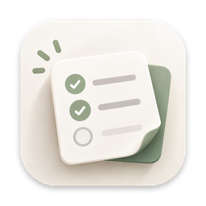
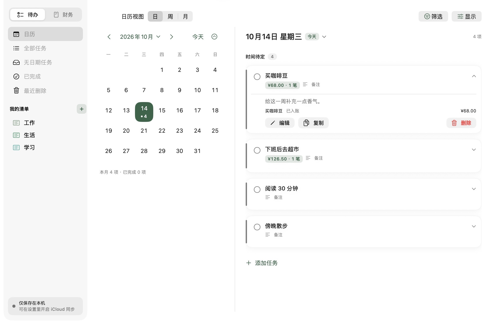
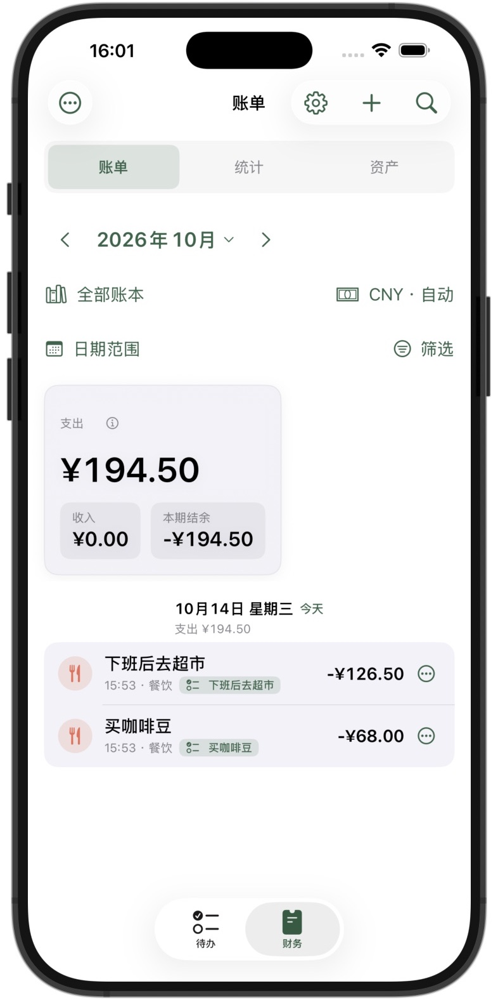

<h1> TallyNest / 小记</h1>

把待办和记账放在一起，适用于 iPhone、iPad 和 Mac。

[支持网站](https://jackhuangzihao.github.io/xiaojitally-support/) · [隐私政策](https://jackhuangzihao.github.io/xiaojitally-support/privacy.html) · [English support](https://jackhuangzihao.github.io/xiaojitally-support/en/) · [Privacy policy](https://jackhuangzihao.github.io/xiaojitally-support/en/privacy.html)

无需注册小记账号；记录保存在本机，可选个人 iCloud 同步；无广告、不做跨应用广告追踪。

## 界面预览

<table>
  <tr>
    <td width="75%" align="center"></td>
    <td width="25%" align="center"></td>
  </tr>
  <tr>
    <td align="center">Mac · 在任务中查看关联账单</td>
    <td align="center">iPhone · 在账单中查看关联任务</td>
  </tr>
</table>

同一笔“买咖啡豆 ¥68”，在待办和账单中相互关联。截图使用示例数据。

## 主要功能

- **待办与记账联动**：为任务关联账单，在安排事情时一起记录相关收支。
- **日历与任务管理**：日／周／月视图、交互排期、清单、重复任务与提醒。
- **账本与统计**：收入、支出、转账、账户、分类、预算、周期账单与财务统计。
- **多设备与备份**：通过个人 iCloud 账号同步，支持本地备份、导出与恢复。

支持 iOS / iPadOS 17 及以上、macOS 14 及以上。工程入口为 `Jianshi.xcodeproj`；目录和代码中的 `Jianshi` 是历史名称。

## 当前状态

1.0 已提交 App Store 审核，最新版本与上架状态以 App Store 为准；各版本变化见 [CHANGELOG](CHANGELOG.md)。

基础待办与记账、任务关联账单、iCloud 同步和备份免费；Pro（月付、年付或买断）提供更多管理额度与进阶统计，同一 App Store 账号可在 iPhone、iPad 和 Mac 恢复。免费额度与订阅说明见[支持网站](https://jackhuangzihao.github.io/xiaojitally-support/)。

## 构建与维护

应用使用 SwiftUI 和 SwiftData 构建。需要 macOS、Xcode 和系统 Python 3。打开 `Jianshi.xcodeproj`；日常调试使用 `Jianshi` scheme，商店构建使用 `Jianshi-AppStore`。自行签名需要自己的开发者团队和对应的应用／iCloud 标识。

- [开发与验证说明](DEVELOPMENT.md)：构建、隔离检查和发布检查。
- [更新记录](CHANGELOG.md)：版本变更及带日期的历史状态。
- [项目维护规范](AGENTS.md)：修改流程和数据保护要求。

App 源码与支持网站统一维护于本仓库。保留 `xiaojitally-support` 名称和 GitHub Pages 原网址，以继续支持已提交的 App。网站从 `main` 根目录发布；源码推送不会上传 App Store 构建。

## 源码许可

采用 **[PolyForm Noncommercial License 1.0.0](LICENSE)**：源码公开，允许非商业学习、使用、修改与再分发，再分发须保留许可及 `Required Notice:` 声明；商业使用须另行取得授权。这不是 OSI 定义的开源许可，也不授予官方 App 的 Pro 权益。[LICENSE](LICENSE) 附中文参考译文，以英文原文为准。

## English

TallyNest brings tasks and personal finance together on iPhone, iPad and Mac.
Link expenses or income to tasks, plan your day, and manage your accounts in one app.
No TallyNest account is required. Records stay on your device, with optional sync through your own iCloud.

[English website](https://jackhuangzihao.github.io/xiaojitally-support/en/) · [Privacy policy](https://jackhuangzihao.github.io/xiaojitally-support/en/privacy.html)
